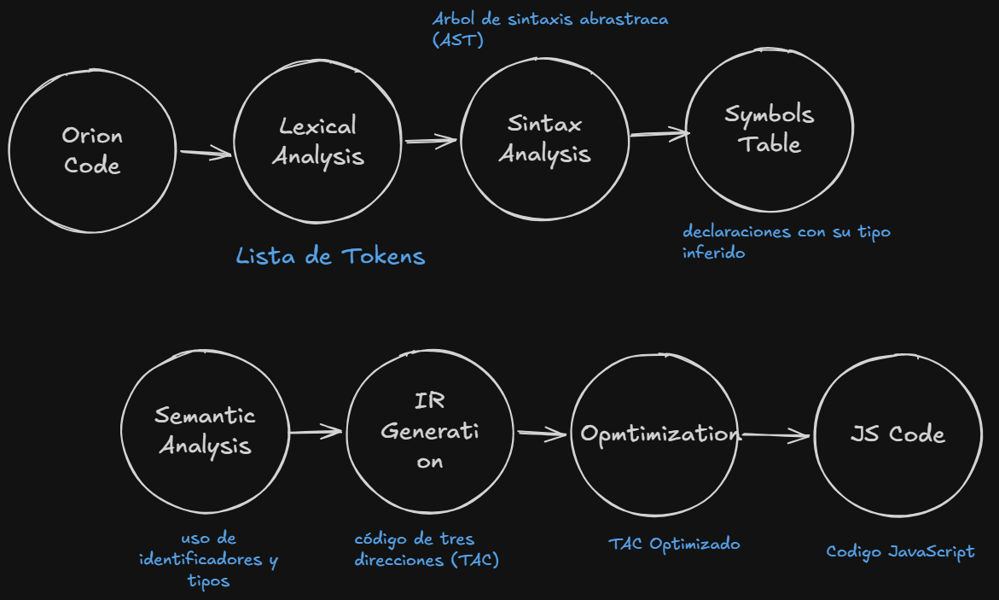

# Orion Compiler

Compilador desarrollado en Java para el análisis y procesamiento de un lenguaje de programación propio. El proyecto implementa las fases de un compilador, desde el análisis léxico y sintáctico hasta el análisis semántico (con comprobación de tipos), la generación de código intermedio y la traducción a JavaScript.

El objetivo es construir una arquitectura modular que permita comprender cómo se transforma un programa fuente en una representación intermedia, facilitando su análisis y el desarrollo posterior de nuevas etapas de compilación.

## Objetivos del proyecto

- Implementar el análisis léxico para reconocer los elementos del lenguaje.
- Analizar la estructura sintáctica de los programas mediante una gramática.
- Construir una representación del programa mediante un árbol de sintaxis abstracta (AST).
- Detectar errores semánticos, como el uso de identificadores no declarados o los errores de tipos.
- Generar código intermedio a partir de la estructura del programa.
- Mantener una arquitectura modular que facilite la extensión del compilador.

## Arquitectura general

El proceso de compilación se organiza en las siguientes etapas:



Cada fase solo se ejecuta si las anteriores terminaron sin errores. Dentro de una fase se informan todos los errores encontrados, no solo el primero.

## Tecnologías utilizadas

- **Java 21** o superior: lenguaje de implementación (usa `record`, interfaces selladas y `switch` con patrones).
- **Maven:** construcción y pruebas (JUnit 5).
- **Git:** control de versiones.

## Estructura del proyecto

```text
orion-compiler/
├── orion, orion.cmd           Lanzadores del compilador (sh / Windows)
├── examples/hello.orion       Programa de ejemplo
├── docs/CLI.md                Diseño de la interfaz de línea de comandos
├── pom.xml
└── src/
    ├── main/java/com/compiler/
    │   ├── Compiler.java      Punto de entrada: CLI y orquestación de las fases
    │   ├── cli/               Opciones de la línea de comandos
    │   ├── lexer/             Lexer, Token, TokenType
    │   ├── parser/            Parser (descendente recursivo)
    │   │   └── ast/           Nodos del AST (records sellados)
    │   ├── semantic/          Tabla de símbolos y análisis semántico
    │   ├── ir/                Código intermedio (cuádruplas / TAC), bloques básicos y grafo de flujo
    │   ├── codegen/           Generación de JavaScript desde el código intermedio
    │   ├── error/             Gestión de errores de compilación
    │   └── util/              Impresión del AST y generador AST → JS (solo como referencia en pruebas)
    └── test/                  Pruebas unitarias y de extremo a extremo
```

### Componentes principales

| Componente                          | Responsabilidad                                                                             |
| ----------------------------------- | ------------------------------------------------------------------------------------------- |
| `Compiler.java`                     | Interpreta la línea de comandos y coordina las fases de compilación.                        |
| `Lexer.java`                        | Reconoce los tokens del programa fuente.                                                    |
| `Parser.java`                       | Analiza la sintaxis, construye el AST y se recupera de errores para informar de todos.      |
| `parser/ast`                        | `Sentencia` y `Expresion`: interfaces selladas cuyos nodos son `record`.                    |
| `SymbolTable.java`                  | Mantiene los identificadores declarados, su tipo y su categoría (variable o constante).     |
| `SemanticAnalyzer.java`             | Comprueba el uso de identificadores, la división entre cero y los tipos.                    |
| `GeneradorCodigoIntermedio.java`    | Traduce el AST a instrucciones de código intermedio.                                        |
| `Cuadrupla.java`                    | Representa una instrucción del código intermedio mediante operación, operandos y resultado. |
| `ProgramaIR.java`, `FuncionIR.java` | Código intermedio estructurado: funciones, programa principal y tabla de tipos.             |
| `GrafoFlujo.java`                   | Divide el código intermedio en bloques básicos y los conecta (base de las optimizaciones).  |
| `GeneradorJS.java`                  | Traduce el código intermedio a JavaScript.                                                  |
| `JSGenerator.java`                  | Traduce el AST a JavaScript; solo se usa en las pruebas para comparar resultados.           |

Como `Sentencia` y `Expresion` son interfaces selladas, cada fase las recorre con un `switch` exhaustivo: al añadir un tipo de nodo nuevo, el proyecto no compila hasta que todas las fases lo manejen.

## Lenguaje fuente

```javascript
let a = 10;
let b = 3.5;
const max = 20;

let c = a + b * 2; // float
a += 1;

if (c > max) {
  print(max);
} else if (c > 0) {
  print(c);
} else {
  print(0);
}
```

### Elementos léxicos

- Números enteros (`10`) y decimales (`3.5`).
- Booleanos `true` y `false`.
- `null`, compatible solo con `string` y con arreglos.
- Cadenas (`"hola\n"`) y caracteres (`'a'`), con los escapes `\n \t \r \0 \\ \" \'`.
- Identificadores: letra o `_` seguida de letras, dígitos o `_`.
- Comentarios de línea `// ...` y de bloque `/* ... */`, que no se anidan.
- Operadores: `+ - * / %`, `== != < <= > >=`, `&& || !`, `= += -= *= /= %=`.

### Gramática

Resumen de la gramática que acepta el parser. La especificación completa (EBNF, reglas de ámbito y de tipos, estado de implementación) está en [`docs/grammar.md`](docs/grammar.md).

```text
programa     -> ( funcion | sentencia )* EOF
funcion      -> "fn" IDENTIFICADOR "(" ( parametro ( "," parametro )* )? ")" ( ":" ( tipo | "void" ) )? bloque
parametro    -> IDENTIFICADOR ":" tipo
sentencia    -> declaracion | asignacion | llamada ";" | imprimir | if | while | for
              | "break" ";" | "continue" ";" | "return" expresion? ";" | bloque
declaracion  -> "let" IDENTIFICADOR ( ":" tipo ( "=" expresion )? | "=" expresion ) ";"
              | "const" IDENTIFICADOR ( ":" tipo )? "=" expresion ";"
tipo         -> ( "int" | "float" | "char" | "string" | "bool" ) ( "[" "]" )*
asignacion   -> destino ("=" | "+=" | "-=" | "*=" | "/=" | "%=") expresion ";"
destino      -> IDENTIFICADOR ( "[" expresion "]" )*
imprimir     -> "print" "(" ( expresion ( "," expresion )* )? ")" ";"
if           -> "if" "(" expresion ")" bloque ( "else" ( bloque | if ) )?
while        -> "while" "(" expresion ")" bloque
for          -> "for" "(" IDENTIFICADOR "in" expresion ")" bloque
bloque       -> "{" sentencia* "}"
llamada      -> IDENTIFICADOR "(" ( expresion ( "," expresion )* )? ")"

expresion    -> logicoOr
logicoOr     -> logicoAnd ( "||" logicoAnd )*
logicoAnd    -> igualdad ( "&&" igualdad )*
igualdad     -> comparacion ( ("==" | "!=") comparacion )*
comparacion  -> termino ( ("<" | "<=" | ">" | ">=") termino )*
termino      -> factor ( ("+" | "-") factor )*
factor       -> unario ( ("*" | "/" | "%") unario )*
unario       -> ("!" | "-") unario | potencia
potencia     -> postfija ( "**" unario )?
postfija     -> primario ( "[" expresion "]" | "." IDENTIFICADOR )*
primario     -> NUMERO | CADENA | CARACTER | IDENTIFICADOR | llamada | "true" | "false" | "null" | "(" expresion ")"
              | "[" ( expresion ( "," expresion )* )? "]"
```

La precedencia y la asociatividad (por la izquierda, salvo `**`, que asocia por la derecha) coinciden con las de JavaScript. Una asignación compuesta `a += b` se traduce a `a = a + b`. Las funciones solo se declaran en el nivel superior y se pueden llamar antes de su declaración; dentro de una función solo son visibles las globales declaradas antes que ella. Las palabras `import`, `from` y `export` están reservadas pero aún no tienen significado.

## Análisis semántico

El análisis semántico se hace en dos pasadas:

1. **Tabla de símbolos:** registra cada declaración, en orden, con su tipo inferido y su categoría (`let` → variable, `const` → constante).
2. **Comprobaciones:** recorre el programa en orden y por bloques comprobando el uso de cada identificador y los tipos.

### Tipos

| Expresión        | Operandos                           | Resultado                                         |
| ---------------- | ----------------------------------- | ------------------------------------------------- |
| `+ - * %`        | numéricos                           | `int` si ambos son `int`; si no, `float`          |
| `+`              | `string`                            | `string` (concatenación)                          |
| `/`              | numéricos                           | `float` (en JavaScript, `7 / 2` es `3.5`)         |
| `**`             | numéricos                           | `float`, aunque ambos sean `int`                  |
| `< <= > >=`      | numéricos, o ambos `char`           | `bool`                                            |
| `== !=`          | del mismo tipo, o ambos numéricos   | `bool`; también `string` o `T[]` con `null`       |
| `&& \|\|` y `!`  | `bool`                              | `bool`                                            |
| `-x`             | numérico                            | el tipo de `x`                                    |
| `x = valor`      | mismo tipo que `x`                  | también `int` a `float` y `null` a `string`/`T[]` |
| `if (condición)` | `bool`                              | —                                                 |
| `for (x in e)`   | `e` es `string` o `T[]`             | `x` es `char` o `T`, de solo lectura              |
| `[e1, e2]`       | con un tipo común `T`               | `T[]`; `[]` toma el tipo del contexto             |
| `a[i]`           | `i` es `int`; `a` es `T[]`/`string` | `T`, o `char` en una cadena (no asignable)        |
| `a.length`       | `a` es `T[]` o `string`             | `int`                                             |

Las variables declaradas dentro de un bloque solo son visibles en ese bloque, igual que `let`/`const` en el JavaScript generado. Cuando una expresión tiene un error, su tipo queda como desconocido y no provoca más errores en cascada.

Los arreglos son invariantes (`int[]` no se asigna a `float[]`) y se pasan por referencia. Un índice fuera de rango detiene el programa con un error en tiempo de ejecución, y lo mismo ocurre al concatenar, indexar, medir o recorrer una cadena o un arreglo que vale `null`.

### Códigos de error

| Código | Fase       | Significado                                                                |
| ------ | ---------- | -------------------------------------------------------------------------- |
| E100   | Léxica     | Carácter no reconocido.                                                    |
| E101   | Léxica     | `&` suelto: se esperaba `&&`.                                              |
| E102   | Léxica     | `\|` suelto: se esperaba `\|\|`.                                           |
| E103   | Léxica     | Cadena o carácter sin cerrar.                                              |
| E104   | Léxica     | Secuencia de escape no válida.                                             |
| E105   | Léxica     | Comentario de bloque sin cerrar.                                           |
| E107   | Léxica     | Literal de carácter vacío o con más de un carácter.                        |
| E201   | Sintáctica | Falta un elemento obligatorio (`;`, `=`, `)`, `}`...).                     |
| E202   | Sintáctica | Instrucción no reconocida.                                                 |
| E203   | Sintáctica | Se esperaba una expresión.                                                 |
| E204   | Sintáctica | Destino de asignación no válido.                                           |
| E205   | Sintáctica | Una expresión usada como sentencia debe ser una llamada.                   |
| E301   | Semántica  | Identificador no declarado.                                                |
| E302   | Semántica  | Identificador declarado dos veces.                                         |
| E303   | Semántica  | Identificador usado antes de su declaración o fuera de su bloque.          |
| E304   | Semántica  | División entre una constante que vale cero.                                |
| E305   | Semántica  | Reasignación de una constante.                                             |
| E306   | Semántica  | Operador aplicado a tipos incompatibles.                                   |
| E307   | Semántica  | Asignación de un valor de tipo incompatible.                               |
| E308   | Semántica  | La condición de un `if` no es `bool`.                                      |
| E310   | Semántica  | Índice que no es `int` o valor que no se puede indexar.                    |
| E311   | Semántica  | Propiedad inexistente: solo existe `.length`.                              |
| E312   | Semántica  | No se puede inferir el tipo (`void`, `null` o `[]` sin contexto).          |
| E313   | Semántica  | `break` o `continue` fuera de un ciclo.                                    |
| E314   | Semántica  | Se llama a algo que no es una función.                                     |
| E315   | Semántica  | Número de argumentos incorrecto.                                           |
| E316   | Semántica  | `return` fuera de una función.                                             |
| E317   | Semántica  | `return` con valor en una función `void`, o sin valor en una que no lo es. |
| E318   | Semántica  | Falta `return` en algún camino de ejecución.                               |
| E319   | Semántica  | `for ... in` sobre un valor que no se puede recorrer.                      |

## Generación de código intermedio

El generador transforma el AST en código de tres direcciones (_Three-Address Code_, TAC). Cada instrucción es una cuádrupla:

```text
(operación, argumento1, argumento2, resultado)
```

Para el programa de ejemplo de la sección anterior (`orion --emit-ir --no-opt ejemplo.orion -o -`):

```text
    a = 10
    b = 3.5
    max = 20
    $t1 = b * 2
    $t2 = a + $t1
    c = $t2
    $t3 = a + 1
    a = $t3
    $t4 = c > max
    ifFalse $t4 goto $L1
    print max
    goto $L2
$L1:
    $t5 = c > 0
    ifFalse $t5 goto $L3
    print c
    goto $L4
$L3:
    print 0
$L4:
$L2:
```

Los temporales (`$t1`, `$t2`...) dividen las expresiones respetando la precedencia, y las etiquetas (`$L1`, `$L2`...) implementan los saltos del `if`/`else`. Llevan el prefijo `$`, que Orion no admite en identificadores, para que nunca coincidan con una variable del programa. Los arreglos usan `$t1 = array 3`, `x = $t1[i]`, `$t1[i] = x` y `$t2 = len $t1`, y un `for ... in` se traduce a un ciclo con índice mediante esas mismas operaciones.

Los operadores `&&` y `||` usan cortocircuito con un temporal de resultado y saltos: `&&` salta al final si el izquierdo es falso; `||` salta a evaluar el derecho si el izquierdo es falso y, si es verdadero, salta al final; el código del derecho se emite después del salto condicional.

Cada declaración conserva su nombre en su primera aparición y recibe sufijos `$1`, `$2`… si el nombre se repite en otros ámbitos; las lecturas y asignaciones usan el nombre IR de la declaración visible. `ProgramaIR` separa las funciones (`FuncionIR`, con nombre, lista de parámetros IR y cuerpo) del código principal; al imprimir, las funciones se listan primero, en orden de declaración, como `func f, n, [parametros IR]` … `endfunc` (sin lista si no hay parámetros), sin que esos delimitadores sean cuádruplas.

El opcode `concat` distingue la concatenación de cadenas de la suma numérica `+`; `ProgramaIR.tipos` guarda el tipo de cada variable, parámetro y temporal por nombre IR, y `tipo(operando)` también reconoce los literales.

La pasada de constantes trabaja por bloque básico: propaga literales, pliega operaciones seguras y simplifica condiciones constantes. Conserva las asignaciones sin uso y no propaga entre bloques. Tras una llamada descarta las constantes globales; conserva los locales y temporales. `--emit-ir` muestra el resultado optimizado y `--no-opt` desactiva las pasadas tanto para TAC como para JavaScript.

## Optimización

Antes de generar el JavaScript, el código intermedio pasa por cuatro pasadas que se repiten hasta que no
cambia nada: plegado y propagación de constantes, propagación de copias, eliminación de código muerto y
simplificación de saltos. Ninguna cambia lo que el programa imprime. Por ejemplo, un programa que calcula
`neto = total - descuento` con valores conocidos y una rama que nunca se cumple queda reducido a `print 30`.

La explicación paso a paso, con ejemplos reales antes y después de cada pasada, está en
[`docs/optimizacion.md`](docs/optimizacion.md). `--no-opt` desactiva las pasadas para comparar.

## Ejecución

Requisitos: JDK 21 o superior y Maven.

```bash
mvn package                       # compila, ejecuta las pruebas y genera target/orion.jar
./orion examples/hello.orion      # genera ./hello.js   (en Windows: orion.cmd ...)
```

Modos principales (uno por invocación):

```bash
orion programa.orion              # compila a programa.js
orion --check programa.orion      # solo valida
orion --emit-ir programa.orion    # genera programa.tac optimizado
orion --emit-ir --no-opt programa.orion # muestra el IR sin optimizar
orion --tokens programa.orion     # muestra los tokens
orion --ast programa.orion        # muestra el AST
orion --help                      # todas las opciones
```

Códigos de salida: `0` éxito, `1` errores en el programa fuente, `2` uso incorrecto, `3` error de E/S. El diseño completo está en [`docs/CLI.md`](docs/CLI.md).

## Pruebas

```bash
mvn test
```

| Suite                                             | Qué cubre                                                                                                                                                        |
| ------------------------------------------------- | ---------------------------------------------------------------------------------------------------------------------------------------------------------------- |
| `LexerTest`                                       | Tokens, operadores, posiciones, comentarios, decimales y errores léxicos.                                                                                        |
| `ParserTest`                                      | Precedencia, asociatividad, sentencias, mensajes de error y recuperación.                                                                                        |
| `SemanticAnalyzerTest`                            | Inferencia y comprobación de tipos, ámbitos y errores semánticos.                                                                                                |
| `GeneradorCodigoIntermedioTest`, `GrafoFlujoTest` | Código intermedio (nombres, cortocircuito, tipos) y bloques básicos.                                                                                             |
| `GeneradorJSTest`, `JSGeneratorTest`              | Generación de JavaScript desde el código intermedio y desde el AST.                                                                                              |
| `EjecucionTest`                                   | Ejecuta con `node` los programas de `src/test/resources/programas/` y compara su salida; además compara el JS desde el código intermedio con el JS desde el AST. |
| `CompilatorTest`                                  | Programas completos: salida, código de salida y archivos generados (golden files).                                                                               |
| `OptionsTest`, `CliTest`                          | Línea de comandos.                                                                                                                                               |

Los _golden files_ (`src/test/resources/golden/`) guardan la salida esperada de programas completos. Tras un cambio de comportamiento deliberado se regeneran con `mvn test -Dgolden.update=true` y se revisan con `git diff`.

## Alcance y trabajo futuro

- Propagación de copias y eliminación de código muerto sobre el código intermedio.

## Documentación académica

Este proyecto sirve como base para estudiar e implementar las fases de un compilador, especialmente el análisis semántico y la generación de código intermedio.

## Autoría

Proyecto académico: **Orion Compiler**.

Desarrollo realizado como parte del estudio de compiladores y lenguajes de programación.
